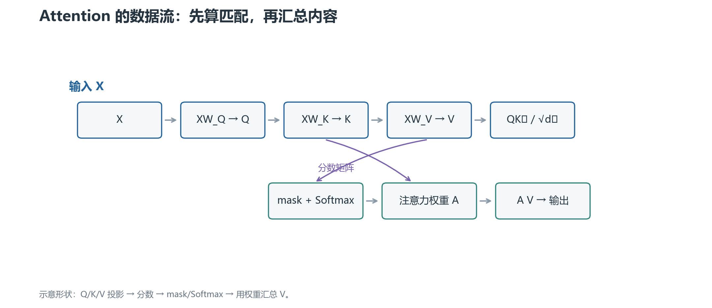

# 01 · 缩放点积注意力：一次查询如何读取其他位置

Attention 的核心动作可以概括成：当前 token 拿着一个查询，去比较其他 token 的键，再按匹配程度汇总它们的值。

## 1. Q、K、V 从哪里来

输入隐藏状态记为 `X ∈ R^{L×d_model}`。`L` 是序列长度，`d_model` 是每个 token 的隐藏维度。

通过三组可学习矩阵得到：

$$
Q=XW_Q,\qquad K=XW_K,\qquad V=XW_V
$$

Q（query）是“我想找什么”，K（key）是“我有什么特征可供匹配”，V（value）是“匹配后真正取走的内容”。这个比喻帮助记忆，但 Q/K/V 的每一维没有固定的人类语义。

## 2. 从一个分数到一整行权重

第 `i` 个位置与第 `j` 个位置的原始匹配分数是点积 `qᵢ·kⱼ`。除以 `√d_k` 后再做 Softmax：

$$
S=\frac{QK^T}{\sqrt{d_k}},\qquad A=\operatorname{softmax}(S)V
$$

`d_k` 是 K 的最后一维。缩放的原因是：如果 Q/K 各维方差近似稳定，维度增大时点积方差会增大，Softmax 更容易饱和；除以平方根把分数尺度拉回可训练范围。

Softmax 在每一行上计算：

$$
\operatorname{softmax}(s_j)=\frac{e^{s_j}}{\sum_t e^{s_t}}
$$

它产生非负、和为 1 的权重。输出位置 `i` 是所有 V 的加权平均，不是只复制一个位置。

## 3. 矩阵形状一定要能对上

若 `X` 是 `[B,L,d_model]`，单头投影后的 Q/K/V 是 `[B,L,d_k]`。于是：

- `QKᵀ` 是 `[B,L,L]`：每个 query 位置对所有 key 位置的分数；
- `Softmax` 后仍是 `[B,L,L]`：每一行是一个 query 的注意力分布；
- `AV` 是 `[B,L,d_v]`：每个 query 位置得到一个汇总向量。

图中最容易混淆的是中间的 `L×L`：它不是 token embedding，也不是最终输出，而是“每个位置应该从哪些位置取多少信息”的权重矩阵。

## 4. mask 在 Softmax 前起作用

### 因果 mask

decoder-only 语言模型预测下一个 token 时，位置 `i` 不能读取未来的 `j>i`。实现上把这些分数改成负无穷附近的值：

$$
S'_{ij}=\begin{cases}S_{ij},&j\le i\\-\infty,&j>i\end{cases}
$$

Softmax 后，被遮住的位置权重近似为 0。

### Padding mask

batch 内样本长度不同时，padding 只是对齐用的占位符。它们不应参与有效注意力。padding mask 与 causal mask 的职责不同，工程中常将二者合并。

不要把 mask 乘在最终输出上；那会让无效位置影响 Softmax 分母。正确位置通常是分数计算后、Softmax 之前。

## 5. Self-attention 与 cross-attention

**Self-attention** 的 Q、K、V 都来自同一序列，Q 和 K 的长度相同。

**Cross-attention** 的 Q 来自一个序列，K/V 来自另一个序列。例如 encoder-decoder 模型中，decoder 用自己的状态查询 encoder 输出。此时 query 长度与 key/value 长度可以不同。

MHA、MQA、GQA 主要讨论 self-attention 中 Q/K/V 的头如何组织；不要用 cross-attention 的来源差异替代这些概念。

## 6. 复杂度与瓶颈

对稠密全注意力，显式形成 `L×L` 分数矩阵时，时间和中间存储大致含有 `O(L²d_h)` 与 `O(L²)` 项。Q/K/V 投影和输出投影大致是 `O(Ld_model²)`，具体主导项取决于长度与模型宽度。

FlashAttention 可以分块计算，减少读写完整 `L×L` 矩阵的显存压力，但没有把稠密注意力的数学依赖变成线性。它是 IO-aware 的精确注意力内核，不等于稀疏注意力。

下一章：[多头注意力](02-多头注意力.md)。
