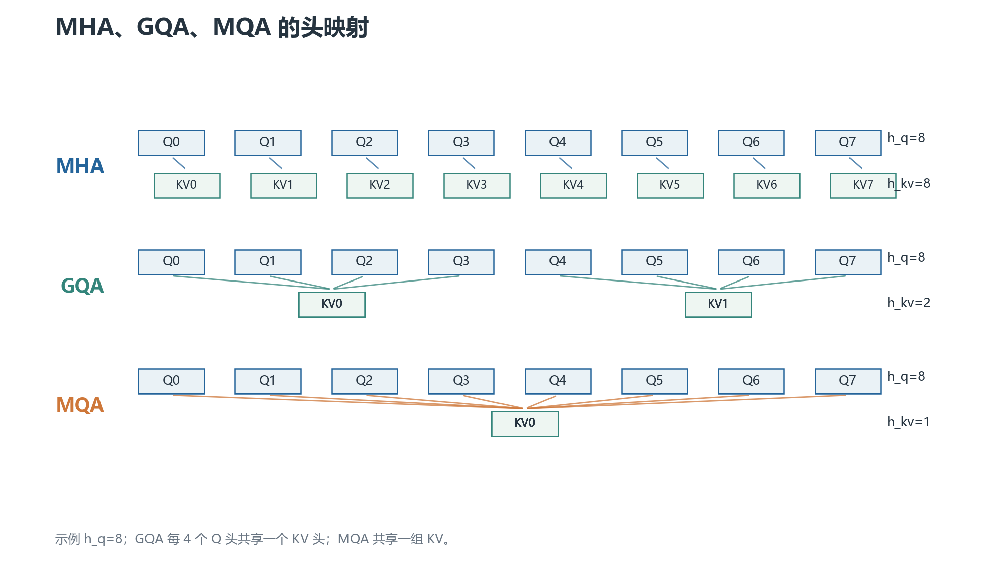
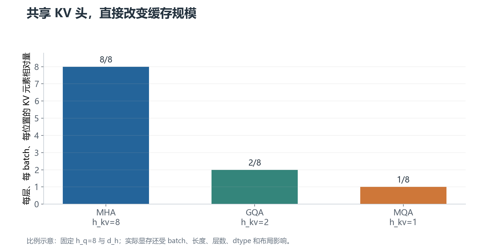

# 03 · MHA、MQA、GQA：Q 头和 KV 头怎样共享

这三个缩写的核心区别只有一个：**query head 有多少个，key/value head 有多少个，以及它们如何对应。**

设 query head 数为 `h_q`，KV head 数为 `h_kv`，每个 head 维度为 `d_h`。

## 1. MHA：每个 Q 都有自己的 K/V

Multi-Head Attention 取：

$$
h_q=h_{kv}=h
$$

第 `r` 个 query head 使用第 `r` 个 key head 和第 `r` 个 value head。没有跨头共享。

KV cache 每层每个位置保存 `2h d_h` 个元素，因此容量最大，但表达自由度也最完整。

## 2. MQA：所有 Q 共享一组 K/V

Multi-Query Attention 取：

$$
h_{kv}=1,\qquad h_q=h
$$

Q 仍然有多个头，K 和 V 各只有一个头。计算时把同一组 K/V 广播给所有 query head。

KV cache 从 `2h d_h` 降到 `2d_h`，理论上按 head 数缩小；但广播不等于复制物理缓存，具体内核可能采用共享视图、分块加载或临时展开。

MQA 降低了推理内存与带宽压力，代价是所有 query head 共享同一组 K/V 表示，可能损失部分质量。这个代价取决于模型和训练方式，不能写成固定百分点。

## 3. GQA：把 Q 头分成若干组共享 K/V

Grouped-Query Attention 介于二者之间：

$$
1<h_{kv}<h_q,\qquad h_q\bmod h_{kv}=0
$$

每组有 `r=h_q/h_kv` 个 query head，共享一个 K head 和一个 V head。映射可以写成：

$$
kv\_index=\left\lfloor\frac{q\_index}{r}\right\rfloor
$$

例如 `h_q=8、h_kv=2`，每组 4 个 Q 头：Q0–Q3 共享 KV0，Q4–Q7 共享 KV1。

GQA 把 KV cache 缩小到 MHA 的 `h_kv/h_q`，同时保留比 MQA 更多的 KV 子空间。许多现代 decoder-only 模型选择这种折中，但具体头数仍要查看模型配置。

## 4. KV cache 内存对比

每层、每个 batch、每个位置的 K/V 元素数量是：

$$
N_{KV}=2h_{kv}d_h
$$

因此相对于 MHA：

| 结构 | `h_kv` | 相对 KV cache |
| --- | ---: | ---: |
| MHA | `h_q` | 1 |
| GQA | `h_kv` | `h_kv/h_q` |
| MQA | 1 | `1/h_q` |

图中只比较结构比例。真实显存还受 batch、序列长度、层数、数据类型、分页缓存和对齐开销影响。

## 5. 为什么 GQA 需要训练或转换

不能只在推理配置里把 `h_kv` 改小，就期待原 MHA 权重自动拥有 GQA 行为。K/V 投影的输出通道、权重排列、缓存布局和 attention kernel 都必须一致。

一种转换思路是把原 MHA 的多个 K/V head 分组平均或选择代表，再用继续训练恢复质量。平均不是唯一方法，也不保证无损。

从头训练时，直接让模型在目标 `h_kv` 下学习，通常更自然；已有模型则需要明确转换策略和校准数据。

## 6. 容易混淆的关系

- MHA/MQA/GQA 描述的是 K/V head 的共享结构，不是位置编码。
- RoPE 通常分别作用在每个 query head 与对应 KV head 的 Q/K 上；共享 K/V 不表示取消 RoPE。
- Multi-head 与 multi-layer 是不同维度：head 是同一层内的并行子空间，layer 是堆叠的 Transformer block。
- GQA 不等于稀疏注意力。每个 query 仍可以看完整的 key 序列，除非另外使用窗口或稀疏 mask。

下一章：[训练与推理实现](04-训练与推理实现.md)。
