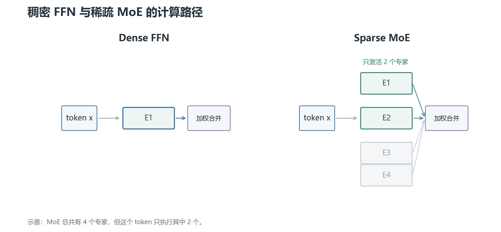

# 01 · 为什么需要 MoE：增加总容量，只让少数专家工作

标准 Transformer 的 FFN 对每个 token 都使用同一组参数。一个常见的 FFN 是：

$$
\operatorname{FFN}(x)=W_2\,\sigma(W_1x+b_1)+b_2
$$

`x` 是 token 的隐藏状态，`W₁` 把维度扩大，激活函数 `σ` 引入非线性，`W₂` 再投影回模型维度。

## 1. 稠密 FFN 的问题

如果把中间维度做得很大，FFN 有更强的表示容量，但每个 token 都要经过完整的 `W₁` 和 `W₂`。总参数量和每 token 的计算量都会增加。

MoE 把一组 FFN 换成多个专家：

$$
\{E_1(x),E_2(x),\ldots,E_N(x)\}
$$

Router 根据 token 的隐藏状态选择少数专家，只计算被选中的结果。总参数量增加，但单个 token 的激活计算主要由 `k` 个专家决定。

这不是“把一个 FFN 分成几块后全部执行”。如果所有专家都执行，就失去了稀疏激活带来的计算收益。

## 2. 一个 token 的 MoE 输出

Router 先产生每个专家的分数 `r(x)`，选择 Top-k 专家集合 `S(x)`。经过归一化后，输出是：

$$
y=\sum_{i\in S(x)}p_i(x)E_i(x)
$$

`pᵢ` 是被选专家的路由权重。它决定不同专家结果在最终输出中的混合比例。

如果 `k=1`，每个 token 只走一个专家；如果 `k=2`，通常计算两个专家再加权。`k` 越大，表达和鲁棒性可能更强，但专家计算、通信和聚合成本也会上升。

图中“未激活”表示该 token 不执行对应专家，并不表示这些专家没有参数或永远不训练。

## 3. MoE 解决的是什么，没解决什么

它主要改变参数容量与每 token 激活计算之间的关系。它不自动解决训练数据质量、长上下文、通信瓶颈或路由不稳定。

专家也不一定天然对应“数学专家”“代码专家”等清晰语义。训练后可以通过统计专家接收的 token 分布来分析，但不能把这种解释当作结构保证。

下一章：[Router 与 Top-k 路由](02-Router与Top-k路由.md)。
