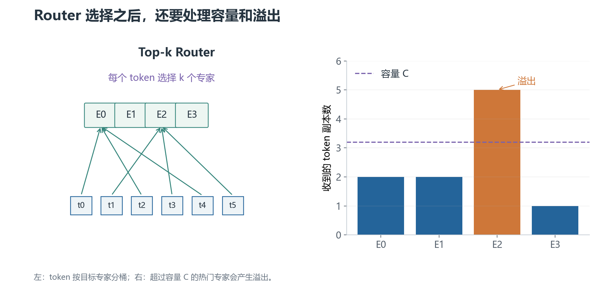

# 02 · Router 与 Top-k 路由：token 先去哪几个专家

Router 是一个小的可学习模块，通常用线性层把 token hidden state 映射成专家 logits：

$$
r(x)=W_rx+b_r\in\mathbb{R}^{N}
$$

第 `i` 个分量表示当前 token 被专家 `i` 处理的倾向。它还不是概率，因为 logits 可以为负，且没有归一化。

## 1. 为什么要 Softmax 和 Top-k

先把 logits 转成路由概率：

$$
g_i(x)=\frac{e^{r_i(x)}}{\sum_{j=1}^{N}e^{r_j(x)}}
$$

如果让所有专家都执行，MoE 退化成稠密组合，成本很高。因此只保留概率最大的 `k` 个专家：

$$
S(x)=\operatorname{TopK}(g(x),k)
$$

实际输出通常使用被选项的权重，并按实现决定是否对 Top-k 权重重新归一化：

$$
y=\sum_{i\in S(x)}\tilde g_i(x)E_i(x)
$$

这里必须查看具体实现；不能把“先全量 Softmax”与“只对 Top-k logits Softmax”混写成同一算法。

## 2. Router 为什么需要噪声或抖动

早期训练时，某些专家可能因为随机初始化或微小优势吸引大量 token。Top-k 是离散选择，轻微分数差也可能造成选择数量突然变化。

一些实现会给 router logits 加噪声，或使用 jitter，让早期选择更有探索性。噪声的形式、训练阶段和推理阶段是否启用取决于模型实现。

噪声不是负载均衡的充分条件。没有容量控制和辅助目标，路由仍可能塌缩到少数专家。

## 3. Capacity：一个专家一次最多收多少 token

一个 batch 有 `T` 个 token，专家数为 `N`，Top-k 为 `k`。平均每个专家接收的 token 副本数约为：

$$
\frac{kT}{N}
$$

考虑不均衡和实现余量后，常设置容量：

$$
C=\left\lceil\operatorname{capacity\_factor}\times\frac{kT}{N}\right\rceil
$$

当某个专家被分配超过 `C` 个 token 时，会发生溢出。实现可能丢弃该路由、把 token 送到 residual/skip 路径，或采用 dropless 的更复杂调度。

容量因子大，溢出少但显存和通信 buffer 更大；容量因子小，资源省但可能丢失 token 的专家计算。

## 4. Dispatch 与 Combine

Router 只产生选择结果，真正的工程步骤还包括：

1. 把 token 按目标专家分桶（dispatch）。
2. 各专家对自己收到的 token 批次执行 FFN。
3. 按原 token 位置和路由权重把结果合回去（combine）。

分布式训练中，token 可能要通过 All-to-All 发到不同设备。于是路由不只是数学选择，也决定通信量和设备间负载。

## 5. Top-1 与 Top-2

Top-1 每个 token 只激活一个专家，计算和通信更省，但路由错误没有第二条路径补偿。

Top-2 激活两个专家，通常将两份结果按权重合并，表达更灵活，但专家计算与容量需求也增加。Top-k 并非越大越好，应结合质量、吞吐、通信和溢出率评估。

下一章：[负载均衡损失](03-负载均衡损失.md)。
