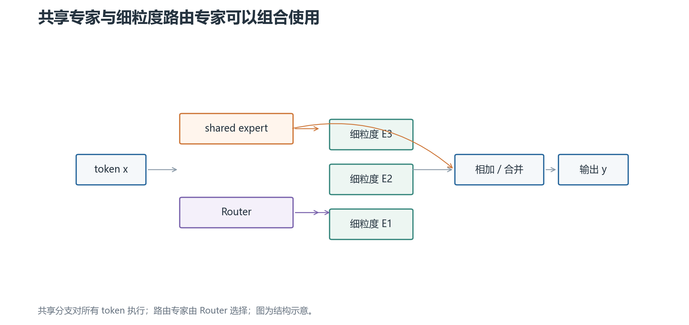

# 04 · 细粒度专家与共享专家

传统 MoE 常把一个较大的 FFN 当作一个专家。现代设计还会改变专家粒度，或者增加一个所有 token 都经过的共享专家。

## 1. 细粒度专家是什么

把原本较大的 FFN 拆成更多、更小的专家，并相应调整每个 token 激活的专家数。例如把每个专家的中间维度缩小，再增加专家总数，让 Top-k 选择组合出更多子空间。

“专家数更多”不等于“激活计算更多”。关键要同时看单专家中间维度、`N`、`k` 和总激活参数量。

细粒度的潜在好处是路由组合更灵活、容量分配更细；代价是 Router 选择、dispatch、通信和元数据管理更复杂。

## 2. 共享专家是什么

共享专家（shared expert）是每个 token 都经过的 FFN 分支；路由专家（routed experts）则由 Router 选择。一个常见组合是：

$$
y=E_{shared}(x)+\sum_{i\in S(x)}p_iE_i(x)
$$

共享分支提供所有 token 都需要的通用变换，路由分支提供条件化的专门容量。

这不是说共享专家一定学“通识”、路由专家一定学“领域知识”。它是结构上的共享与选择，不是语义标签。

## 3. 为什么共享专家可能帮助路由

如果所有 token 都必须从路由专家中选择通用基础功能，Router 可能在热门专家之间争抢容量。共享专家承担一部分共同变换后，路由专家可以把容量留给更有区分度的模式。

但共享专家也增加了每 token 的稠密计算和参数。它不能免费解决专家拥塞，也不能代替负载均衡损失。

## 4. 怎样公平比较两个 MoE 结构

至少固定或报告：总参数量、每 token 激活参数量、专家中间维度、`N`、`k`、共享分支、容量因子、溢出策略和通信布局。

只说“专家更多”或“激活参数更少”无法比较实际成本。共享专家会增加固定 FLOPs；细粒度专家可能增加 dispatch 开销；GQA、量化和并行策略也会影响端到端结果。

下一章：[训练与推理实现](05-训练与推理实现.md)。
