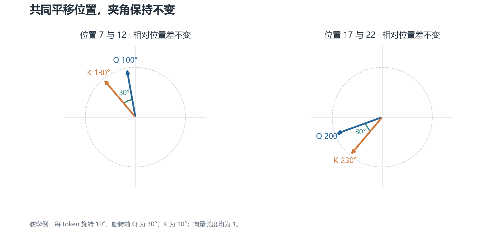
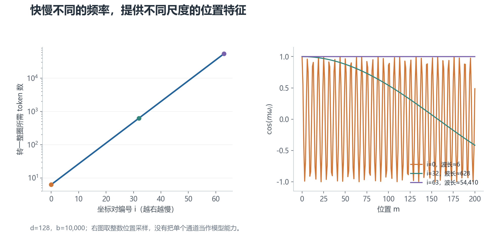

# 01 · RoPE：让注意力知道两个 token 相隔多远

先考虑一个简单问题：模型如何区分“狗追人”和“人追狗”？

词的内容相同，顺序却改变了意思。所以模型不仅需要知道“是什么”，还需要知道“在哪里”。RoPE 是把位置信息放进注意力计算的一种方法。

## 1. 先把注意力里的三个角色讲清楚

### Token 与位置

模型先把文本切成 **token**，也就是分词器处理的基本单元。一个汉字可能是一个 token，也可能与其他字符合成一个 token；英文单词也可能被拆成几个 token。

每个 token 被转换成一串数字，即向量。位置编号 `m` 表示它在当前序列中的位置，从 0 开始。

### Q、K、V 各自做什么

在每一层注意力中，模型把输入向量通过三个可学习的线性变换，得到三个新向量：

- **Q（query，查询）**：当前 token 用什么条件寻找相关信息。
- **K（key，键）**：其他 token 用什么特征与查询匹配。
- **V（value，值）**：匹配之后，实际参与汇总的信息。

可以把它们理解成“搜索条件、索引、内容”。这是帮助理解的比喻，不代表向量的每一维都对应某个可读的语义。

当前位置 `m` 与候选位置 `n` 的匹配分数是：

$$
a_{mn}=\frac{q_m^T k_n}{\sqrt{d_h}}
$$

这里，`qₘ`、`kₙ` 是对应的 Q、K 向量；上标 `T` 表示转置，乘起来得到点积。`dₕ` 是一个注意力头的维度，除以它的平方根用来控制分数尺度。

随后用 **Softmax** 把分数变成和为 1 的权重，再按权重汇总 V。分数越大，通常得到的权重越大。

对于因果语言模型，还要在 Softmax 前遮住未来位置。这样预测下一个 token 时，模型只能使用已经出现的内容。

### “多头”是什么意思

多头注意力让多个注意力头并行计算，各自使用自己的 Q/K/V 表示。RoPE 通常在每个头内部应用，而不是把整个模型的隐藏维度当成一个旋转空间。

后文的 `d` 专指参与 RoPE 的维度。示例让 `d = dₕ = 128`；一些模型只旋转头内的部分维度，或者 Q 与 K 的头数不同。

## 2. 为什么需要位置编码

只看 Q 和 K 的内容匹配，注意力没有完整的词序信息。位置编码负责补上这部分信息。因果遮罩会限制可见范围，但它不能替代具体的位置表示。

早期 Transformer 把位置向量加到 token 的输入向量上。位置向量可以是可学习的，也可以由正弦、余弦计算。

两者不能混为一谈：**学习式位置表可能受表长限制；正弦位置编码可以计算更大的位置。** 能算出来，不等于在更长文本上一定工作得好。

RoPE 换了一个注入位置的地方：它不直接改输入 embedding，而是在注意力打分前，按位置旋转 Q 和 K。

## 3. 先看一个二维例子

把一个二维向量画成平面上的箭头。RoPE 按位置编号转动它：

$$
\phi_m=m\omega
$$

`ω` 是每前进一个 token 增加的角度，单位是“弧度/token”。弧度是角度的另一种单位：一整圈为 `2π` 弧度，1 弧度约为 57.3°。

`φₘ` 是位置 `m` 对应的旋转角。旋转改变方向，不改变向量长度。

假设这一对维度的角速度为每 token 10°，Q 原来指向 30°，K 原来指向 10°。这个角速度只是教学用数字。

Q 在位置 7：旋转 70°，新方向是 100°。

K 在位置 12：旋转 120°，新方向是 130°。

两个新方向的差为 −30°，也就是：

$$
(30^\circ-10^\circ)+(7-12)\times10^\circ=-30^\circ
$$

**位置的贡献只剩下 `7 − 12`。** 如果两个 token 同时向后平移 10 个位置，位置差仍为 −5，这部分计算不变。

**看图时关注夹角。** 左边使用位置 7 和 12，右边改成 17 和 22。两支箭头的绝对方向变了，但相对夹角不变，因此在这组固定 Q/K 下，点积不变。

这里有一个重要限定：我们固定了旋转前的 Q 和 K。真实模型的 Q/K 本身取决于上下文，不能因此说“任意两段文本只要距离一样，注意力分数就一样”。

## 4. 二维旋转如何变成 RoPE

对一对坐标 `(x, y)`，旋转角 `φ` 后的新坐标是：

$$
x'=x\cos\phi-y\sin\phi
$$

$$
y'=x\sin\phi+y\cos\phi
$$

RoPE 对 Q 和 K 的坐标对分别做这个操作。一个 128 维的旋转向量可以分成 64 对，每对都在自己的二维平面中旋转。

“二维平面”在这里是数学上的分组，不是模型里真的有 64 个物理表盘。

教学上常用相邻维度配对，如 `(0,1)`、`(2,3)`。实际实现也可能把前后两半配对；只要权重布局和旋转约定一致，两种写法都可以。迁移代码时不能只改配对方式。

## 5. 为什么每对维度要用不同角速度

如果所有维度都用同一个角速度，就只得到一种周期变化。RoPE 用一组快慢不同的角速度，提供多个尺度的位置特征。

常见的频率安排是：

$$
\omega_i=b^{-2i/d},\qquad i=0,1,\ldots,d/2-1
$$

`i` 是坐标对的编号；`d` 是旋转维度；`b` 是底数。经典示例取 `b = 10,000`。

第 0 对的 `ω₀ = 1`，每前进一个 token 转 1 弧度。往后的坐标对转得越来越慢。

如果想知道转一整圈需要多少 token，可以计算 **波长**：

$$
\lambda_i=\frac{2\pi}{\omega_i}
$$

**左图看尺度，右图看变化速度。** 在 `d = 128`、`b = 10,000` 下，第 0 对的波长约为 6.28 token；第 32 对约为 628 token；第 63 对约为 54,410 token。

快的通道让相邻位置有较大的角度差；慢的通道让较大距离仍产生缓慢变化。这是频率设计的直觉，不能理解成“某一对维度只负责语法，另一对只负责长文检索”。模型如何使用这些特征由训练决定。

多频率也不意味着无限长度下的位置绝对不会混淆。有限维表示和有限计算精度，都需要纳入实际考虑。

## 6. RoPE 在哪里使用，V 为什么通常不旋转

标准的处理顺序是：先得到 Q/K/V，按头组织，再对 Q/K 应用 RoPE，接着计算匹配分数、加遮罩、做 Softmax，最后汇总 V。

只旋转 Q/K 已经能让匹配分数包含相对位置。标准 RoPE 因此保留 V 的原有表示，用它承载被汇总的内容。

这是一种设计选择，不是“旋转 V 在数学上没有意义”。其他注意力结构可以采用不同设计，但不能与标准 RoPE 混在一起解释。

RoPE 通常没有额外的可学习参数，不过生成或缓存正弦、余弦，以及执行旋转，都有计算和存储成本。

## 7. 先记住这三件事

**RoPE 用位置决定旋转角。** Q 和 K 在打分前被旋转。

**固定旋转前的 Q/K 时，旋转带来的位置项由相对位置决定。** 严格推导见数学补充。

**频率设计提供位置特征，不保证长度泛化。** 长文本还需要合适的数据、训练和评测。

下一章：[如何扩展上下文长度](02-长度扩展方法.md)。
