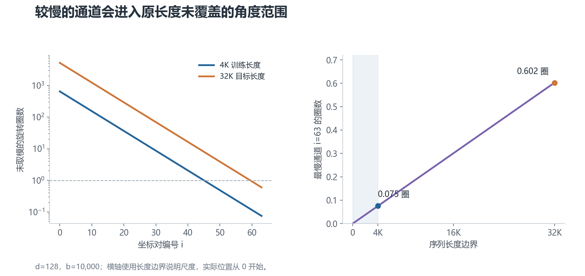
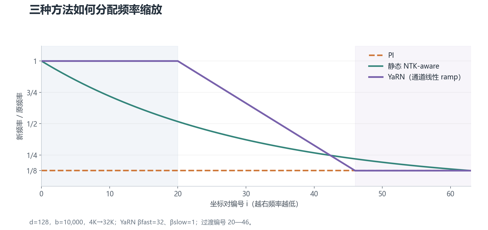
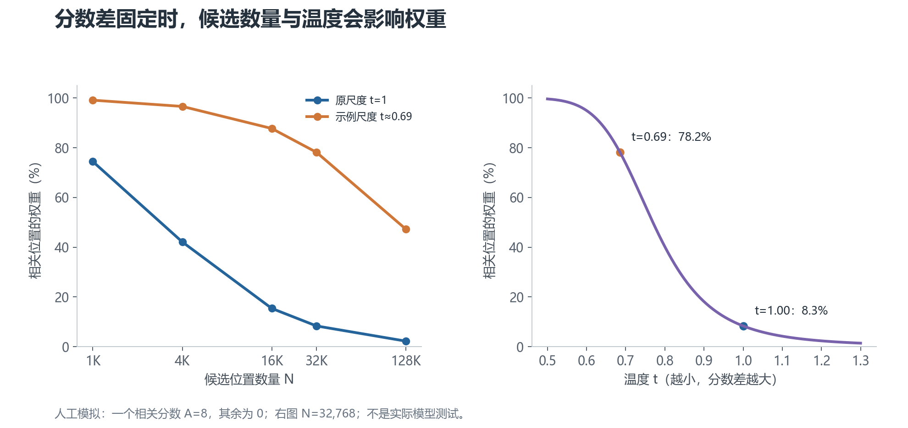

# 02 · 从 4K 到 32K：位置该怎么处理

上一章解释了 RoPE 如何表示位置。这一章讨论另一件事：模型只在较短序列上训练过，现在希望它处理更长序列。

下面统一用一个例子：原训练长度为 4,096 token，目标长度为 32,768 token，扩展倍数为 8。

## 1. 先区分三个容易混淆的长度

**训练序列长度**是训练中实际使用的长度。不同训练阶段可能采用不同长度，也可能混合使用长短序列。

**允许输入长度**是实现和配置允许接收的长度。把配置中的上限改大，只说明程序可能接受更长输入。

**有效上下文长度**是模型在给定任务上能可靠使用的范围。它需要通过评测确认，而且检索、推理、总结等任务可能得到不同结果。

所以，“配置支持 128K”和“模型能够可靠推理 128K 内容”不能直接画等号。

## 2. 外推与内插分别是什么

**外推**：继续使用原来的位置规则，计算训练范围以外的位置。例如仍然用 `mωᵢ`，只是 `m` 从几千增长到几万。

**内插**：把更长的坐标范围压回原来的尺度。例如把位置 `m` 换成 `m/8`，使目标长度边界对应原来的训练长度边界。

这里的“内插”是位置尺度映射，不是在两个 token 之间插入新的 token。

RoPE 的公式能够计算任意位置，但模型不一定适应这些位置产生的表示。这叫 **分布偏移**：推理时的输入特征、距离或任务条件，与训练时不同。明显超出训练分布的情况常被称为 OOD（out of distribution）。

## 3. 直接外推为什么可能出问题

看一对转得很慢的维度。在 4K 范围内，它可能只转过一小段；扩展到 32K 时，转过的角度明显更大。

**图里画的是未取模的旋转圈数。** 最慢的一对从约 0.075 圈增至约 0.602 圈。右图说明：它进入了训练长度内未覆盖的角度范围。

高频通道在训练范围内已经绕过很多圈，但也不能说它“绝对不怕外推”。单个通道的相位重复，不代表多通道组合、相对距离分布和注意力行为都保持不变。

长文本还增加了干扰信息、候选位置和任务难度。**低频相位变化是理解外推风险的一条线索，不是所有失败的唯一原因。**

## 4. PI：把所有位置统一缩小

**Position Interpolation（PI，位置内插）**采用最直接的比例变换。

设扩展倍数为：

$$
\alpha=\frac{L_{\mathrm{target}}}{L_{\mathrm{train}}}
$$

计算旋转时，把位置改为：

$$
m'=\frac{m}{\alpha}
$$

在本例中，`m/8` 把 32K 的位置尺度映射回 4K。位置编号实际从 0 开始，所以目标末尾是 32,767，不是 32,768；这里用长度边界说明比例关系。

从另一种写法看，它等价于把所有角速度统一除以 8：

$$
\omega'_i=\frac{\omega_i}{\alpha}
$$

### 它改善什么，又改变什么

PI 控制了各通道在目标长度下的角度范围，减少直接跨入新范围的问题。

代价是相邻两个 token 的角度差也缩小了。原来相差 1 个位置，现在在映射坐标中只相差 0.125，模型熟悉的位置特征发生变化。

这可能影响短程行为，但不能说模型一定“分不清相邻词”。内容表示仍然存在，变化是否影响性能以及影响多少，需要测量。

PI 通常配合长序列继续训练，让模型适应新尺度。原论文报告的适应成本较低，也不能反过来概括成“必须大量重训才能勉强补救”。

## 5. NTK-aware：快的少改，慢的多改

PI 对所有通道一视同仁。**NTK-aware scaling**则尝试保留最高频，把更大的缩放留给低频。

这个名称借用了神经切线核（NTK）的分析视角。理解这里的频率变换不需要先学习 NTK 理论，也不应把名字理解成性能保证。

一种常见的静态规则是把 RoPE 底数改为：

$$
b'=b\alpha^{d/(d-2)}
$$

将新底数代回频率公式，会得到：

$$
\frac{\omega'_i}{\omega_i}=\alpha^{-2i/(d-2)}
$$

第 0 对不变，最后一对恰好缩为原来的 `1/α`，中间逐渐过渡。这解释了它为什么能保留最高频的相邻位置角度差。

但中间通道的缩放小于 PI 的压缩程度，它们在目标长度下仍可能进入原训练范围以外的角度。**保留最高频不等于所有短程行为完全不变；缩放最低频也不等于消除所有分布偏移。**

有些实现还提供 dynamic NTK，根据当前序列长度改变缩放。它与固定的静态规则不同。使用 KV cache（缓存已经计算的 K/V 以加速生成）时，尤其要确认旧缓存与当前旋转规则是否一致。

## 6. YaRN：按训练时转了多少圈来分段

**YaRN**把频率调整和注意力分数尺度调整结合起来。它是一种长上下文扩展方案，通常仍需适应训练与评测。

### 先理解“训练范围内的圈数”

对第 `i` 对维度，定义：

$$
r_i=\frac{L_{\mathrm{train}}\omega_i}{2\pi}
$$

`rᵢ` 表示这一对维度在原训练长度内转过多少圈。

圈数多的通道转得快；圈数少的通道转得慢。YaRN 根据这个量划分频段：

- 高频段：保留原频率，即继续外推。
- 低频段：使用 PI 式的频率压缩。
- 中间段：在两种频率之间平滑混合。

用 `γᵢ` 表示保留原频率的权重，范围是 0 到 1：

$$
\omega'_i=\gamma_i\omega_i+(1-\gamma_i)\frac{\omega_i}{\alpha}
$$

`γᵢ = 1` 时不缩放；`γᵢ = 0` 时完全内插。

典型规则用两个圈数阈值定位过渡区，例如 `βfast = 32`、`βslow = 1`，再在通道编号上做 **线性 ramp（渐变权重）**：让 `γᵢ` 从高频端的 1 均匀下降到低频端的 0。

不同实现的取整、边界与配置项可能不同，不能仅凭一条示意曲线互换实现。

**纵轴表示新频率/原频率。** 1 表示不改，1/8 表示压缩八倍。横轴越向右，通道越慢。

PI 是水平线；NTK-aware 从 1 逐渐降到 1/8；图中的 YaRN 保留一段高频，在中频过渡，然后让低频停在 1/8。图按明确的阈值与通道 ramp 计算，不把过渡段人为画成 S 曲线。

### 为什么还要调整注意力分数

先看 Softmax 如何从分数得到权重：

$$
p_j=\frac{\exp(a_j/t)}{\sum_k\exp(a_k/t)}
$$

`exp(x)` 表示 `e` 的 `x` 次方；`aⱼ` 是候选位置的注意力分数，`pⱼ` 是其权重，`t` 是温度。温度小于 1 时，分数差被放大，权重通常更集中。

如果一个相关位置得分为 `A`，另外 `N−1` 个干扰位置都得分为 0，它的权重就是：

$$
p=\frac{\exp(A/t)}{\exp(A/t)+N-1}
$$

这个简化例子说明：分数差固定时，候选位置增多，相关位置的权重可能降低。真实模型的分数并不固定，也不是所有干扰位置都相同，所以不能说长上下文必然把注意力平均摊薄。

**这是人工设定分数的模拟。** 左图比较候选位置数量变化，右图在 32K 候选位置下比较不同温度。它展示机制，不对应任何模型的实测检索率。

YaRN 常见的尺度建议为：

$$
c=1+0.1\ln\alpha
$$

如果 Q、K 都乘以 `c`，点积会乘以 `c²`，对应上面的温度 `t = 1/c²`。本例 `α = 8` 时，`t` 约为 0.69，而不是固定取 0.4。

这只是常见规则，具体库和模型可能有自己的尺度配置。分数放大也会强化错误匹配，因此它不能替代训练，更不能保证“大海捞针 100%”。

## 7. 增大底数与扩展训练是什么关系

底数越大，除了最高频，其他通道的频率越低，波长越长。

例如在 `d = 128` 下，`b = 500,000` 时最慢通道的波长约为 256 万 token；`b = 1,000,000` 时约为 506 万 token。具体数字取决于旋转维度。

这些较慢的特征可以参与长上下文设计，但**大底数本身不是可靠长上下文的证明**。尤其对一个已经训练好的模型，直接改底数会改变原有位置特征，需要评估是否适应。

也不能把所有模型统一描述成“预训练大底数，最后都用 YaRN”。模型家族乃至同一系列的不同版本，会使用不同规则。判断实际方案时，应检查精确模型版本的配置、实现和技术报告。

## 8. 方法之间怎么比较

| 方法 | 改动 | 需要重点验证的风险 |
| --- | --- | --- |
| 直接外推 | 保持原位置规则 | 超训练长度后是否失效 |
| PI | 所有频率除以扩展倍数 | 改变短程位置尺度后的退化 |
| 静态 NTK-aware | 改底数，逐通道缩放 | 中间频段仍然外推的影响 |
| YaRN | 分频段缩放，加分数尺度调整 | 阈值、尺度与训练是否匹配 |

这是一组设计选择，不是从“必崩”到“终极方案”的性能排名。实际效果取决于底座模型、扩展倍数、训练数据和评测任务。

下一章：[扩展训练到底怎么做](03-扩展训练实践.md)。
