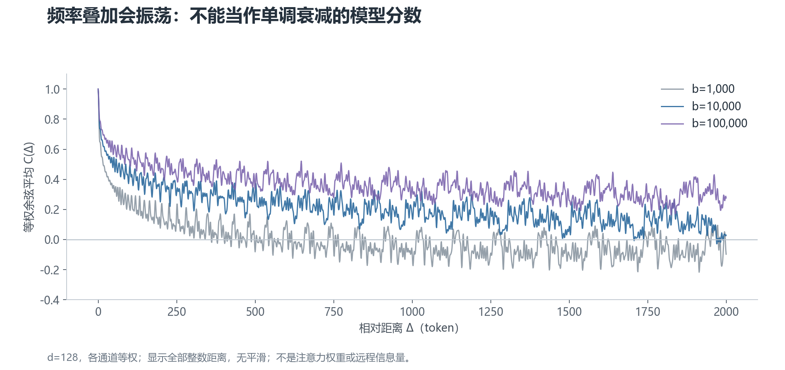

# 04 · 数学补充：公式成立的条件

本章不增加主线必需的新概念。它解释前文公式的来源，并说明哪些结论有条件。

## 1. 旋转为什么留下相对位置

记 `R(m)` 为位置 `m` 对应的旋转矩阵。每个二维块的角度为 `mωᵢ`，所有块组成完整旋转矩阵。

第一章的两个坐标公式，也可以写成这个 2×2 矩阵。左边是旋转后的坐标，右边是原坐标：

```text
┌ x′ ┐   ┌ cos φ   −sin φ ┐ ┌ x ┐
│    │ = │               │ │   │
└ y′ ┘   └ sin φ    cos φ ┘ └ y ┘
```

旋转矩阵是 **正交矩阵**：转置等于逆矩阵。旋转的合成就是角度相加，因此：

$$
R(m)^T R(n)=R(n-m)
$$

旋转后的 Q/K 分别为 `R(m)qₘ` 与 `R(n)kₙ`。它们的点积为：

$$
\big(R(m)q_m\big)^T\big(R(n)k_n\big)=q_m^T R(n-m)k_n
$$

右边的旋转矩阵只依赖位置差 `n−m`。Q/K 的内容项仍然保留，这正是 RoPE 的相对位置性质。

如果用“Q 的方向减 K 的方向”描述同一个二维例子，会写成 `m−n`。两种符号约定是一致的：必须同时保持向量顺序和旋转定义，不能只看差值的符号。

## 2. 用复数可以怎样理解

二维坐标 `(x, y)` 可以写成复数 `z = x + iy`，其中 `i² = −1`。

欧拉公式把角度和复数联系起来：

$$
e^{\mathrm{i}\phi}=\cos\phi+\mathrm{i}\sin\phi
$$

乘以这个复数，相当于旋转 `φ`，长度不变。

两个二维向量的点积等于 `q` 乘以 `k` 的共轭，再取实部。共轭把虚部取负号，也就是把角度取负。

因此，对 `q` 乘以位置旋转 `eⁱᵐω`，对 `k` 乘以 `eⁱⁿω` 后，点积中的位置因子是 `eⁱ⁽ᵐ⁻ⁿ⁾ω`。这就是复数版本的相对位置推导。

如果旋转前的 Q/K 长度为 `r_q`、`r_k`，方向为 `ψ_q`、`ψ_k`，这对二维坐标贡献的点积是：

$$
r_qr_k\cos\big(\psi_q-\psi_k+(m-n)\omega\big)
$$

这同时保留了内容向量的长度、方向差和位置差，不能只取其中的 `cos((m−n)ω)` 当成真实匹配分数。

实数坐标实现和复数实现都可用。选择哪一种，取决于张量布局、库和内核，不是因为 GPU 无法处理复数。

## 3. “远程衰减”究竟能说明什么

可以把各通道的余弦相加，构造一个用于观察频率集合的函数：

$$
C(\Delta)=\frac{2}{d}\sum_{i=0}^{d/2-1}\cos(\Delta\omega_i)
$$

它相当于让所有通道贡献相同权重、没有额外相位偏移时的位置核示例。



**曲线会振荡，不保证逐点下降。** 改底数会改变曲线的尺度，但不能把纵轴叫作“真实模型保留下来的远程信息量”。

真实点积每个二维块都有由 Q/K 决定的系数。相关理论中的衰减分析或上界，需要相应条件；它不等于任意 Q/K 的点积随距离严格单调递减。

因此，图可以帮助理解不同频率如何叠加，不能用来证明增大底数一定提高长文能力。

## 4. 为什么最高频是 1，不是奈奎斯特定理的唯一答案

在频率公式 `ωᵢ = b⁻²ⁱ/ᵈ` 中，`i = 0` 的指数是 0，所以最高频为 1。这是该参数化的选择。

离散位置采样时，频率有周期等价关系。例如每步角度 `ω` 和 `ω + 2π` 在整数位置给出相同的复指数。对余弦信号还存在正负频率等价。

奈奎斯特分析帮助解释这些离散频率关系，但不会唯一推出 `ω = 1` 最优。

尤其是 `ω = 2` 弧度/token 仍小于 `π`，不能说它已经越过奈奎斯特界限。余弦周期性反弹也不等于整个多频率 RoPE 的位置表示发生混淆。

PI 实际上连最高频也会缩放。因此，“所有扩展方法都不敢碰最高频”的说法不成立。

## 5. NTK-aware 缩放公式从哪里来

原频率为 `b⁻²ⁱ/ᵈ`，新底数设为 `bαᵈ/⁽ᵈ⁻²⁾`。把后者代入并与原频率相除，得到：

$$
\frac{\omega'_i}{\omega_i}=\alpha^{-2i/(d-2)}
$$

当 `i = 0` 时，缩放为 1。

当 `i = d/2 − 1` 时，指数为 −1，缩放为 `1/α`。

因此，公式满足两个端点目标：最高频不动、最低频与 PI 一样缩放。这只是频率规则的推导，不是对模型外推效果的严格保证。

## 6. 分块旋转的“完备性”有什么前提

考虑一类连续、保长度、按位置差组成的线性变换，可写成 `R(m) = exp(mB)`，其中 `B` 是实反对称矩阵，即 `Bᵀ = −B`。

线性代数给出的结论是：可以选择一个正交基，把 `B` 化成二维旋转生成块和可能的零块。于是这类更一般的旋转，可以改写成分块旋转。

如果 Q/K 来自自由可学习的线性投影，共同的基变换可以吸收进投影权重。从这种表示能力的意义上，二维分块不是随意丢掉了其他旋转形式。

但这不证明经典固定频率最优，不保证训练过程一样，也不覆盖任意非线性或非保长度的位置编码。更不能推出“所有长度扩展问题都只与频率有关”。
