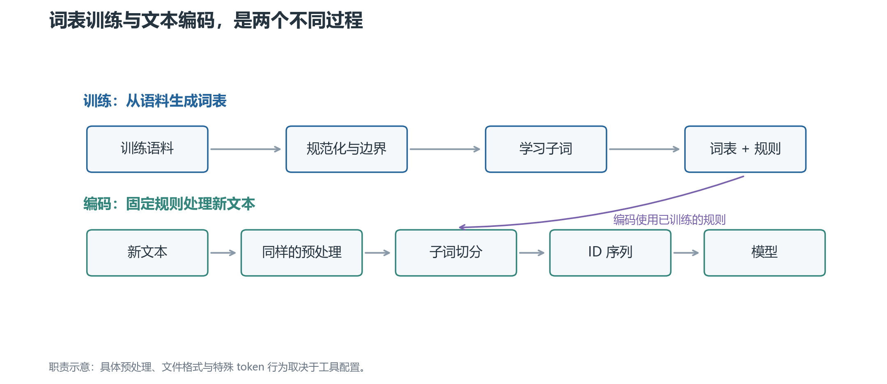

# 01 · 文本怎样变成模型能接收的编号

一段文字进入语言模型之前，首先经过 **tokenization（分词或标记化）**：把文本拆成模型使用的基本单元，并转换成整数 ID。

这里的“分词”不一定是按自然语言里的完整词切分。`playing` 可以是一个 token，也可以是 `play` 和 `ing`；一个汉字可能是一个 token，也可能拆成多个字节 token。

## 1. 先分清字符、字节和 token

**字符**是文本中的符号，例如 `A`、`中`。处理 Unicode 时，还要区分字符编码的码点与人眼看到的字形；一个显示出来的字形可能由多个码点组成。

**字节**是计算机编码文本的基础单位。采用 UTF-8 时，`A` 通常占 1 字节，`中` 占 3 字节。一个字节不是一个汉字，也不是固定的一段意思。

**Token**是分词器选定的单元。它可以对应完整词、子词、字符、一个字节，或者一串字节。

因此，“一个 token 等于多少字”只能在指定模型、语言和文本上做统计，不能当作普遍换算关系。

## 2. 为什么通常不直接按完整词切分

如果每个完整词都占一个词表位置，英文的时态变化、专有名词，以及代码中的新标识符，会让词表不断膨胀。中文又没有天然的空格词边界。

另一端是只用字符或字节。这样基础单位少，但常见长词也需要很多 token，序列更长。

**子词（subword）**在两者之间取折中：把常见片段收进词表，不常见的字符串拆成较小片段。片段可以像词根、词尾，也可能只是一串常见字符，不保证有独立语言学意义。

## 3. 词表是什么，ID 又是什么

**词表（vocabulary）**是模型能够使用的有限 token 集合。每个 token 对应一个整数 ID，例如下面这个人为指定的词表片段：

| Token | ID |
| --- | --- |
| `play` | 0 |
| `ing` | 1 |
| `!` | 2 |

如果分词结果是 `play | ing | !`，就可以编码成 `[0, 1, 2]`。这些数字只是编号，不表示“play 的意思比 ing 小”，也不是词频。

语言模型拿到 ID 后，查找 **embedding（嵌入）**：每个 ID 对应一行可学习的向量。通常先确定分词器与词表，再在模型训练中学习这些向量。

所以，词表生成与 embedding 学习是不同过程。分词器能把词切出来，并不说明模型已经理解了这个词。

## 4. 一个完整分词器通常有哪些步骤

先看流程中的职责，再讨论具体算法。

**上半部分是训练分词器，下半部分是编码新文本。** 词表与切分规则通过训练生成，之后供编码使用；不会为每一次用户输入重新生成一份词表。

### 规范化：先决定保留哪些文本差别

**Normalization（规范化）**可能包括大小写转换、Unicode 规范化等。例如把某些兼容字符转换成统一形式。

这样会减少表示差异，但也可能丢失信息。若把 `Apple` 改成 `apple`，解码后无法自动知道原来首字母是大写。

### 预切分：先划定局部处理范围

**Pre-tokenization（预切分）**可以按空格、标点或规则先把文本分段，然后在每段内部应用子词算法。

例如先把 `hello, world` 划成若干段，再对各段使用 BPE。普通的词内 BPE 不会跨已经确定的边界合并。具体边界取决于实现，不是 BPE 名字本身规定的。

有些系统直接处理规范化后的整段文本，不要求外部先做语言学分词。SentencePiece 属于这个方向，但它仍然可能根据空白、文字类型等配置约束候选片段。

### 子词切分与 ID 映射

BPE、WordPiece 或 Unigram 在这里决定：用词表中的哪些片段表示当前文本。

随后查词表得到 ID。为了完成这一步，通常不止需要一个 `token → ID` 字典；还可能需要合并顺序、概率分数、前缀约定等规则。

### 后处理与解码

**后处理**可能插入句首、句尾等特殊 token，或者组织多段输入。聊天模板还会加入角色和轮次结构，这不等于子词算法本身。

**解码**把 ID 转回文本，处理空白标记、字节拼接等细节。如果前面的规范化丢失了信息，或者解码主动跳过特殊 token，就不能保证还原原始输入的每一个字符。

## 5. “训练分词器”和“使用分词器”有什么区别

训练阶段读取语料，决定哪些片段进入词表，以及新字符串应该怎样切分。

使用阶段保持词表和规则固定，把新文本转为 ID。通常也叫 encode；反向过程叫 decode。

对于标准文本生成模型，输出层同样对应这份词表。模型每一步预测下一个 token ID，最后再解码为文字，并不是直接生成汉字或完整单词。

后文始终把这两条线分开讲：先问词表怎么来，再问固定词表如何使用。

下一章：[BPE 与 WordPiece](02-BPE与WordPiece.md)。
