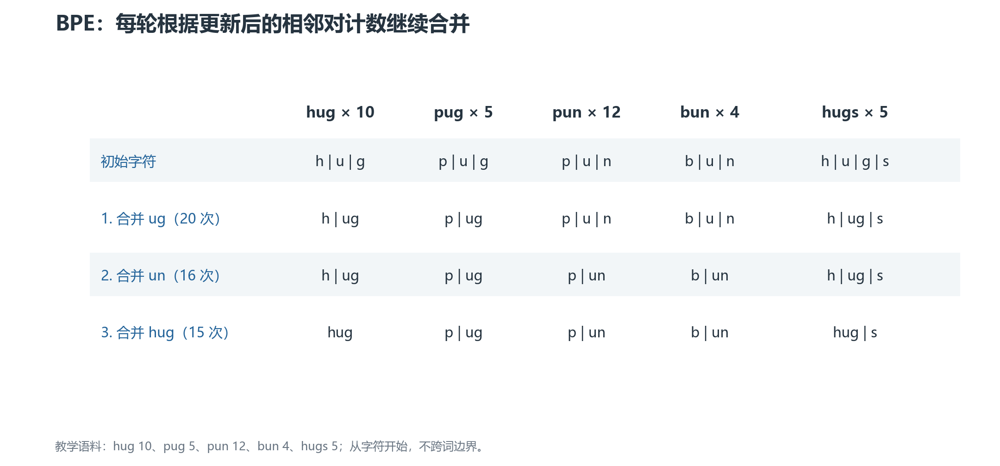
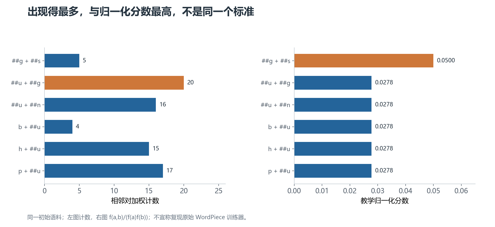

# 02 · BPE 与 WordPiece：合并什么，怎样切新词

BPE 和 WordPiece 都能从较小单元出发，逐渐加入更大的子词。但它们的训练选择和编码规则并不相同。

本章使用同一份小语料，实际计算计数。为方便观察，所有词已经转成小写并按词预切分，不跨词边界合并。

## 1. 一份可以手算的训练语料

| 词 | 出现次数 |
| --- | --- |
| `hug` | 10 |
| `pug` | 5 |
| `pun` | 12 |
| `bun` | 4 |
| `hugs` | 5 |

“出现次数”会作为训练权重。例如 `hug` 的 `h u g` 这条序列，在统计时贡献 10 份计数。

**相邻对**指一条序列中左右相接的两个单元。`h u g` 有 `(h,u)` 和 `(u,g)` 两个相邻对。

## 2. BPE：先合并出现最多的相邻对

**BPE（Byte Pair Encoding，字节对编码）**最早用于数据压缩。应用到子词分词时，通常反复合并最常见的相邻单元。

名字里的“Byte”不表示所有 NLP 版本都从字节开始。本节从字符开始，下一章之后会说明字节级方案。

### 第一步：准备最小单元

词表最初包含语料用到的字符：`b, g, h, n, p, s, u`。

所有词都拆成字符。例如 `hugs → h | u | g | s`。

### 第二步：统计相邻对

`u g` 同时出现在 `hug`、`pug` 和 `hugs` 中，计数为 `10 + 5 + 5 = 20`。

其他候选包括 `p u` 的 17 次、`u n` 的 16 次，以及 `h u` 的 15 次。最高的是 `u g`，因此先加入新 token `ug`。

合并后：

```text
hug  → h | ug
pug  → p | ug
pun  → p | u | n
bun  → b | u | n
hugs → h | ug | s
```

### 第三步：重算，继续合并

计数必须按新切分重新计算，不能沿用旧相邻对列表。

下一轮 `u n` 出现 16 次，因此合并成 `un`。再下一轮 `h ug` 出现 15 次，合并成 `hug`。



**每一行都是上一轮更新后的结果。** 新 token 来自统计，但不会自动删除基础字符。因此前三轮后，词表包含原来的 7 个字符，以及 `ug`、`un`、`hug`。

实际训练通常按目标词表大小或合并次数停止，也可能设最小出现频次等条件。候选计数并列时，具体实现的择优规则会影响结果。

## 3. BPE 编码不是简单的“找最长词表项”

词表固定后，BPE 还需要训练得到的 **merge rank（合并优先级）**，通常由合并发生的先后顺序决定。

新词先拆成基础单元，然后按可用合并的优先级逐步合并。例如只使用上面三条规则，`hugs` 会先得到 `h | ug | s`，再得到 `hug | s`。

为什么词表字典本身还不够？看这个专门构造的小例子：

```text
优先规则 1：b + c  → bc
优先规则 2：a + b  → ab
输入：abc
```

BPE 先应用优先级更高的 `b+c`，得到 `a | bc`。

如果只是从左往右选最长词表项，则会选 `ab | c`。两者不同，所以不能把 BPE 编码说成“最大匹配分词”。

## 4. WordPiece：为什么不是只看相邻对计数

**WordPiece**也是子词方案，BERT 的分词器是它的常见实例。

原始训练过程与语言模型似然有关。**似然**可以理解为：当前子词模型给训练语料赋予了多大的概率。更能解释语料的候选，可能比单纯出现多的候选更有价值。

这里有一条需要明确的边界：原始训练实现没有完整公开。很多教学材料用下列归一化分数说明合并偏好，但不能把它当成所有 WordPiece 训练器的精确公式。

$$
s(a,b)=\frac{f(a,b)}{f(a)f(b)}
$$

`f(a,b)` 是相邻对的加权计数；`f(a)` 和 `f(b)` 是两个单元各自的加权出现次数。这里的分数是比较指标，不是一个合法的片段概率，也不能直接代替语言模型似然增益。

直观上：如果 `a`、`b` 到处都出现，它们碰到一起就不一定值得优先形成新 token；如果它们相对更常结伴，归一化后的分数可能更高。

## 5. 先介绍 `##`，再看训练例子

典型 BERT WordPiece 用 `##` 标记“这个片段接在词的中间”，例如 `playing → play | ##ing`。

`##` 是 token 字符串中的约定，不是原文中真的有两个井号，也不是所有 WordPiece 系统都必须采用的符号。

在我们的例子里，`hugs` 的初始形式是 `h | ##u | ##g | ##s`。词首 `h` 与词内 `##h` 是不同的词表项。

### 同一语料为什么会得到不同选择

`##u` 出现 36 次，`##g` 出现 20 次，`##s` 出现 5 次。

`##u ##g` 出现 20 次，分数为 `20/(36×20) = 1/36 ≈ 0.0278`。

`##g ##s` 只出现 5 次，但分数为 `5/(20×5) = 1/20 = 0.05`。

所以按这个教学评分，先加入的是 `##gs`，而不是 BPE 首轮的 `ug`。



**左图看原始计数，右图看教学分数。** 两套规则对同一个候选集合产生不同排序；这说明训练目标会改变词表，不是证明 WordPiece 永远优于 BPE。

继续训练时，同样要更新切分和计数。收进词表的子词也不一定是完整单词。

## 6. WordPiece 编码：从左到右贪心找最长匹配

**贪心**指每一步先选择当前看起来最合适的选项，不回头枚举整条字符串的所有切分。典型 WordPiece 使用最长前缀匹配。

假设固定词表包含：

```text
play, ##ing, ##er, ##s, [UNK]
```

对 `playing`，从词首找最长可用片段，得到 `play`；剩余 `ing` 要按词内形式查询，找到 `##ing`。结果是 `play | ##ing`。

这里不需要按训练时的合并顺序重新合并。**BPE 编码依赖合并优先级，WordPiece 编码主要依赖词表及词首/词内约定。**

### 匹配失败时会怎样

`[UNK]` 是 unknown token，即未知 token。

对 `playz`，虽然开头能找到 `play`，但剩下的 `z` 没有可用的 `##z`。典型 BERT WordPiece 会把整个预切分单元输出为 `[UNK]`，不是保留 `play` 再只把 `z` 替换成未知符号。

具体系统可能采用不同回退策略，还可能限制单词长度；迁移时应检查真实实现。

## 7. 这两个方案怎样生成词表

两者通常都从基础单元开始，反复增加子词；区别在于候选选择的目标，以及生成词表后如何切分新文本。

BPE 常见的交付物是词表和有序合并规则。WordPiece 常见的交付物是词表，加上规范化、预切分、词内前缀和未知处理等配置。

只复制一份可见 token 列表，可能无法复制原分词器的完整行为。

下一章：[SentencePiece 与 Unigram](03-SentencePiece与Unigram.md)。
