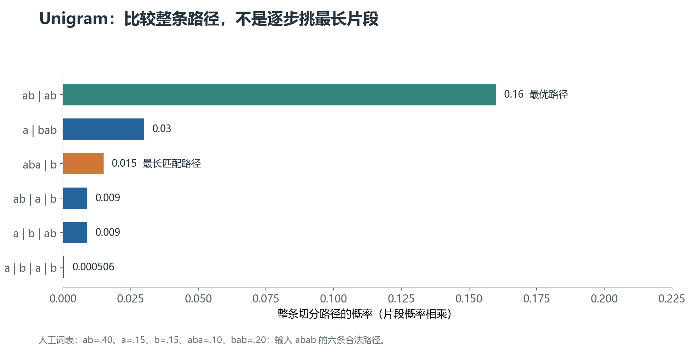

# 03 · SentencePiece：工具、空白标记与概率切分

上一章讨论了两种子词方法。这一章先澄清名称：**SentencePiece 是训练和使用分词器的工具，不是一种与 BPE 完全互斥的算法。**

它支持 BPE、Unigram，以及字符、词级模型等选项。这里重点讲它的文本处理方式与 Unigram。

## 1. 为什么强调“从原始句子训练”

很多子词训练流程先按完整词切分，再在词内学习片段。对于没有自然空格词边界的中文、日文，这一步可能依赖语言专用分词器。

SentencePiece 可以直接从句子文本训练，不要求外部先给出语言学意义上的词边界。输入会经过它配置的规范化和训练规则。

“不要求外部分词”不等于“完全没有边界约束”。例如按空白、数字或文字类型约束候选片段的配置，仍然会影响哪些 token 能被学出来。

## 2. `▁` 是什么，为什么经常出现在词前

SentencePiece 常用 `▁`（U+2581，下划块）作为空白的可见表示。它不是普通下划线 `_`。

比如，在一份假设词表中：

```text
原文：I love NLP
内部示意：▁I▁love▁NLP
可能切分：▁I | ▁love | ▁N | LP
```

这些片段只是示例，不是指定 SentencePiece 模型的实测输出。

开头的 `▁` 不一定表示原文真的以空格开头。默认配置通常会添加一个 dummy prefix（虚拟前缀），让句首也能按类似词边界的形式处理。

这个标记可以被包含在一个更长 token 内，因此 `▁love` 与 `love` 可能是不同词表项。

### 能否原样恢复所有空格

如果空白被作为符号保留下来，解码就更容易重建边界。但 SentencePiece 常用的默认规范化还会处理连续空白等差异，并采用基于 NFKC 的 Unicode 规范化。

**NFKC**是一种兼容性规范化：将某些外观或编码不同的兼容字符转换成统一形式。这可能改变原始文本。

因此，不能仅看到 `▁` 就承诺逐字符还原所有原始空白与字形。是否可逆，需要结合规范化、虚拟前缀与空白配置讨论。

## 3. SentencePiece 使用 BPE 时，学的仍是合并规则

选择 `model_type=bpe`，核心仍然是相邻单元的统计合并。

区别是它把文本处理、空白标记、训练、模型文件与解码整合到同一工具中。生成的词表可能带有 `▁`，而不是 BERT 式的 `##`。

**算法相同，不代表配置相同或输出相同。** 预处理、基础单位、边界约束、语料与目标词表规模变化，都可能改变结果。

## 4. Unigram：先给每个片段一个概率

**Unigram（单元语言模型）**在这里是假设每个子词独立出现的概率模型。它用于判断切分，不是说后面的 Transformer 也不看上下文。

假设某条切分得到片段 `t₁, t₂, …, tₖ`，每个片段有概率 `p(tⱼ)`。这条切分路径的概率是：

$$
P(t_1,\ldots,t_k)=\prod_{j=1}^{k}p(t_j)
$$

右侧的乘积符号表示把所有片段的概率相乘。片段概率属于分词器模型，与大模型预测下一个 token 的概率不是同一份参数。

同一字符串可能有多条合法切分。Unigram 通常选择路径概率最高的一条，而不是每一步都挑最长片段。

## 5. 一个例子：最长片段不一定组成最好路径

假设只有下面五个候选，概率人为指定并且总和为 1：

| 片段 | 概率 |
| --- | --- |
| `ab` | 0.40 |
| `a` | 0.15 |
| `b` | 0.15 |
| `aba` | 0.10 |
| `bab` | 0.20 |

要切分 `abab`，如果从左往右贪心找最长片段，会得到 `aba | b`，路径概率为 `0.10×0.15 = 0.015`。

但 `ab | ab` 的概率为 `0.40×0.40 = 0.16`，明显更大。



**图里比较完整路径，而不是单个 token。** `a | bab` 的概率是 0.03，也高于最长匹配路径。最优结果要综合后续位置能如何切分。

工程实现通常用 **动态规划**：在每个字符位置保留最佳前缀结果，并向后扩展合法片段。它避免为长字符串显式枚举指数增长的全部路径。这类最大概率路径搜索常叫 Viterbi 解码。

计算时通常将概率转为负对数成本，乘积变成加和，选最大概率就等价于选最小成本。具体推导不是理解词表生成的前提。

## 6. Unigram 词表如何生成：从大候选集逐步删减

与 BPE 常见的“逐步添加”不同，Unigram 通常先准备一份比目标词表更大的候选集合。

### 准备候选片段

从语料中抽取候选子串，同时保留必要的基础字符等单位，使文本仍有切分路径。

这里的“必要”取决于字符覆盖与回退设置，不是声称任意 Unicode 字符都已经在候选集内。

### 根据可能切分估计概率

当前词表会让一个句子存在多条切分。训练不能简单假定最长匹配就是唯一真实切分，而是考虑各种路径对语料概率的贡献。

一句话的概率通常要把所有合法切分路径的概率加起来：

$$
P(x)=\sum_{z\in S(x)}\prod_{t\in z}p(t)
$$

`x` 是输入字符串；`S(x)` 是所有合法切分的集合；`z` 是其中一条路径；`t` 是路径中的某个 token。重复出现的 token 会重复贡献乘积。

这里用“所有路径概率之和”估计语料解释能力，而上一节编码时用“概率最大的路径”。**训练目标与最佳路径解码不是同一个运算。**

常见训练过程通过 **EM（期望最大化）**交替更新：先根据当前概率，估计不同切分中各片段的使用量；再据此更新片段概率。训练使用高效算法累加路径贡献，不需要把所有路径逐条列出来。

### 评估删除候选的代价

可以用训练语料的负对数似然作为损失：

$$
\mathcal{L}=-\sum_x w_x\log P(x)
$$

`wₓ` 是该句子的出现次数或权重，`log` 是自然对数。取对数可以把概率乘积转换成加和；加上负号后，概率越低，成本越高。

考察删除一个片段之后，其他切分能否较好地替代它，以及损失增加多少。代价小的片段更可能被删；必要的字符或控制符则可能受保护。

具体训练器使用高效的近似评估与批量裁剪，不是每次删除一个片段都完整重训所有候选。

### 裁剪、重估，直到达到目标规模

删掉一部分候选后，重新估计概率，再继续裁剪，直到得到目标词表。

所以最终留下的不是简单的“全语料出现最多的前 N 个子串”，而是能够共同解释语料的片段集合。

## 7. 为什么同一文本有时会得到不同切分

默认编码通常选择最佳路径，是确定的。训练时也可以从可能路径中采样，让同一句话以不同子词组合出现。

这种 **subword regularization（子词正则化）**用切分变化增加训练输入的多样性。BPE 也有通过随机跳过合并实现的 BPE-dropout，两者机制不同。

如果评测需要可复现的 token 数，必须确认是否关闭了采样。不能把采样结果当成固定分词器每次必然的输出。

下一章：[词表生成与工程实践](04-词表生成与工程实践.md)。
