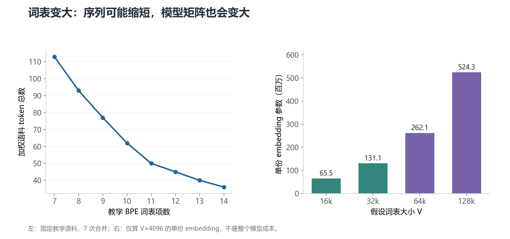

# 04 · 词表生成：算法之外还有哪些决定

选定 BPE、WordPiece 或 Unigram，只决定了部分训练行为。语料组成、规范化、字符覆盖和词表规模同样会改变结果。

一个实用问题是：怎样生成适合中文、英文和代码混合场景的词表，又怎样知道它确实合适？

## 1. 从训练目标出发选语料

分词器会把词表位置分配给训练语料中的片段。如果语料主要是英文，英文片段更容易获得较长 token；低比例语言可能更多依赖短片段。

因此先决定要服务哪些语言和领域，再进行抽样、去重和配比。中文、代码、数学表达、数字、罕见人名等，可以各自准备独立验证样本。

不能只把语料按文件大小拼起来。重复网页、模板和垃圾字符串可能抢占词表位置。清洗方式也要记录，否则后续难以复现词表。

分词器验证集应与训练语料隔离，以检查新词、陌生脚本和实际输入形式的处理情况。

## 2. 固定预处理：它决定算法实际看到什么

先明确大小写是否保留、Unicode 如何规范化、连续空格和换行如何处理，以及是否先按空格或标点划分片段。

对代码而言，大小写、缩进、换行可能有实际意义；对标识符而言，`Foo` 与 `foo` 也可能不是同一个对象。不能因为某种清洗能减少词表，就默认它适合所有任务。

这些配置需要同时用于训练和编码。训练看到一种文本形式、上线看到另一种形式，会引入不必要的差异。

## 3. 先确定基础覆盖，再谈大子词

### 字符覆盖率

**字符覆盖率**通常指保留的字符覆盖了训练语料中多少字符出现次数，而不是覆盖了多少种 Unicode 字符。

一个罕见字符可能因目标覆盖率而被排除。降低覆盖率能节省基础词表位置，但若没有回退机制，遇到它时可能输出未知 token。

### 字节级 BPE

字节级 BPE 从 UTF-8 字节出发，而不是直接从 Unicode 字符出发。一个完整的 256 字节基础集合，可以表示任意有效 UTF-8 文本所需的字节。

某些实现会把字节映射成可打印的 Unicode 符号，方便存储和展示。因此可见词表项不一定就是原文里的字符。

字节可以继续合并成较长 token。例如 `中` 的 UTF-8 字节为 `E4 B8 AD`，但是否恰好占 3 个 token，要看这三个字节有没有形成已学到的合并。

一个 token 也可能只包含一个汉字的部分 UTF-8 字节，单独显示时不是完整字符。解码要先拼接完整字节流，而不是逐个 token 独立当作 UTF-8 文本解码。

### Byte fallback：字符方案的兜底

**Byte fallback（字节回退）**与“始终从字节级基础单位开始”不同。它通常在字符/子词方案无法表示某字符时，把它退回对应的字节 token。

例如有些词表用 `<0xE4>` 这类形式展示字节项。仅加入 256 个普通字符串，还不等于实现了真正回退；训练和编码器必须支持并启用该规则。

SentencePiece 的 `byte_fallback` 是配置选项，不是所有 SentencePiece 模型的默认保证。这 256 个字节项也会占用词表预算。

字节覆盖可以减少未知文本问题，但不能恢复已经在规范化阶段丢掉的差异。

## 4. 特殊 token 从哪里来

特殊 token 不一定由统计合并学出。它们通常由配置、模型架构或任务约定保留。

- `[UNK]` 或 `<unk>`：表示无法正常编码的单元。
- BOS/EOS：句首或序列起始、序列结束标记。
- PAD：将不同长度样本对齐时使用的填充标记。
- 角色或任务标记：用于聊天轮次、工具消息或其他任务结构。

这些名字和 ID 不通用；某些模型也不使用其中某项。例如 PAD 是否存在、是否与 EOS 共用，要检查具体模型。

新增一个特殊字符串时，还要决定是否作为不可拆分单元、是否自动插入、解码时是否跳过。**特殊 token 的行为来自配置，不是因为字符串看起来有尖括号就自动生效。**

## 5. 词表规模怎样影响序列长度与成本

更多词表位置可以容纳更多长片段，但并不保证所有文本都用更少 token，更不保证模型一定更好。

先看一份确定的教学语料。在 BPE 训练中逐步加入合并，观察同一语料的 token 总数如何变化。

**左图的下降来自实际运行教学 BPE，不是模型性能实验。** 它反映这份训练语料受合并影响后的长度，不能直接推断陌生语料也按同样幅度下降。

### 词表也占模型参数

设词表大小为 `V`，模型隐藏维度为 `D`，输入 embedding 大约需要：

$$
N_{\mathrm{embed}}=V\times D
$$

如果 `V = 32,000`、`D = 4,096`，就是约 1.31 亿个参数。只存一份 BF16 权重时，每参数 2 字节，约为 262 MB；这不含梯度、优化器状态和其他模型层。

**BF16**是一种占 2 字节的浮点数格式。这里用十进制 MB 表示存储量，不与二进制 MiB 混用。

输出预测也通常需要把隐藏向量映射到 `V` 个候选 token 的分数。如果输入 embedding 与输出权重绑定，可以共享一份权重；不绑定时通常还要额外一份类似规模的矩阵。具体架构可能有例外。

图的右半部分只计算一份 embedding 的参数量，未把它当作整个模型的参数总数。

### 较大词表并非总是合算

常见长片段可以减少序列长度，进而影响上下文利用和注意力成本；较大词表同时增大 embedding 和输出层，并把训练出现次数分散到更多 token 上。

一些罕见片段即使进入词表，也可能没有足够训练信号学好对应向量。评估应同时考虑 token 效率、语言覆盖和模型成本，而不是只追求更大的数字。

## 6. 词表生成后，要交付什么

至少保存能够恢复完整编码/解码行为的模型文件与配置。

BPE 的独立实现可能使用 `vocab.json` 与 `merges.txt`；WordPiece 常见文本词表；SentencePiece 常见 `.model` 与可读 `.vocab`。这些是常见形式，不是所有工具必须采用的文件名。

可读 `.vocab` 通常不足以替代 SentencePiece 的完整模型文件，因为规范化、片段类型和其他配置也需要保存。

如果使用 `tokenizer.json` 等整合格式，同样要核查它是否连同特殊 token 配置、聊天模板和模型需要的附加文件完整交付。

ID 分配也要固定下来。它不是由“词频越大 ID 越小”这一普遍规则决定的；特殊 token 顺序和训练器实现都可能影响编号。

## 7. 换词表为什么会影响已有模型

已经训练好的模型，其 embedding 和输出权重按原 ID 排列。把一个词表字符串换成另一个，或者重新排列 ID，会改变编号对应的意义。

即使两份词表大小相同，也不能直接互换。

如果只是追加新 token，通常需要扩大输入/输出矩阵，并通过训练让新行得到有用表示。还要检查新 token 是否改变原文本的切分；更长片段可能优先匹配，从而影响原有输入。

从头更换分词器，则通常需要权重映射、进一步训练或重新训练。它不是“改一个词表文件”就能完成的维护操作。

## 8. 怎样评测生成的词表

先按中文、英文、代码、数字和特殊文本分别测，不用一个混合平均值掩盖局部问题。

推荐记录以下项目：

| 项目 | 它回答什么 |
| --- | --- |
| Token 数与长度分布 | 同一验证文本会占多少上下文位置 |
| 未知 token 与字节回退比例 | 哪些内容没有获得常规子词覆盖 |
| 解码一致性 | 能否还原预期保留的内容与空白 |
| 编码/解码速度 | 分词本身是否成为数据管线瓶颈 |
| 下游任务结果 | 接入或训练模型后，实际能力是否改善 |

“每词多少 token”适合有明确定义的词边界时比较；中文与混合文本可以补充每字符、每 UTF-8 字节等指标。比较时固定规范化、文本集合与计数方式。

困惑度也不能无条件跨分词器直接比较，因为 token 单元改变了。若要比较语言建模效率，可以采用统一的字符/字节归一化等评测设计，而不是只看每 token 的分数。

## 9. 用一句话分别记住这些名称

**BPE**：常见训练方式是从小单元开始按相邻对频次合并，编码遵循合并优先级。

**WordPiece**：训练偏向能改善子词模型的候选；典型编码是带词内约定的最长前缀匹配。归一化合并分数属于教学近似。

**Unigram**：从较大候选集出发估计片段概率并裁剪，编码通常选择整条字符串的最佳概率路径。

**SentencePiece**：把规范化、空白处理、训练、编码和解码整合起来的工具，可选择 BPE 或 Unigram 等模型。

最后阅读：[可复现实验与参考资料](05-实验与参考资料.md)。
